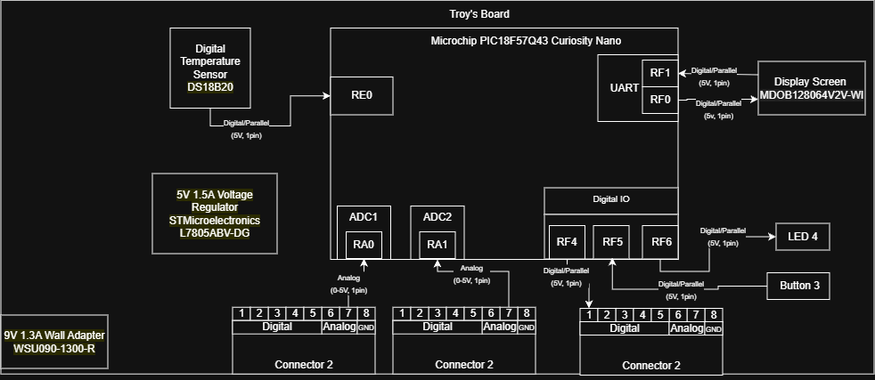

## Overview

The block diagram uses a Temperature Sensor (DS18B20) Which is a 1 pin digital sensor to send information through my nano board into an LCD (MDOB128064V2V-WI). Additionally, I will be recieving information from the Light and Moisture Sensors that will also be displayed on the LCD. Along with displaying the temperature I will send that temperature to control a motor which will spin a fan. I use a 9V 1.3A wall connector external power supply to power my board.

I connect to all three of the boards, recieving information from one and two and sending information to three. 

## Example Block Diagram 

