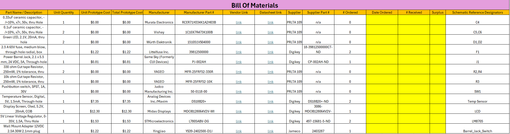

## Overview

This Bill of Materials documents Team B.A.M.F.'s temperature sensor module and display, with all the necessary parts (with suppliers and datasheets) per prototype unit. This serves as documentation to the necessary parts that make up the subsystem, so it can be referred to and replicated.

Some important notes: The unit quantity is how many of the component in the individual module, the unit cost is how much each individual component costs, and the total prototype cost is how much a it would cost to complete a prototype with the parts. # Ordered is extra parts for breadbaording and replacements if need be, not how many are necessary.

## Bill of Materials

{style width: "2000"}

**Figure 1:** Bill of Materials as a screenshot.

## Resources

The BOM as a PDF download is available [here](bom.pdf), and a Microsoft Excel Sheet [here](BOM_TO_EGR304.xlsx).
