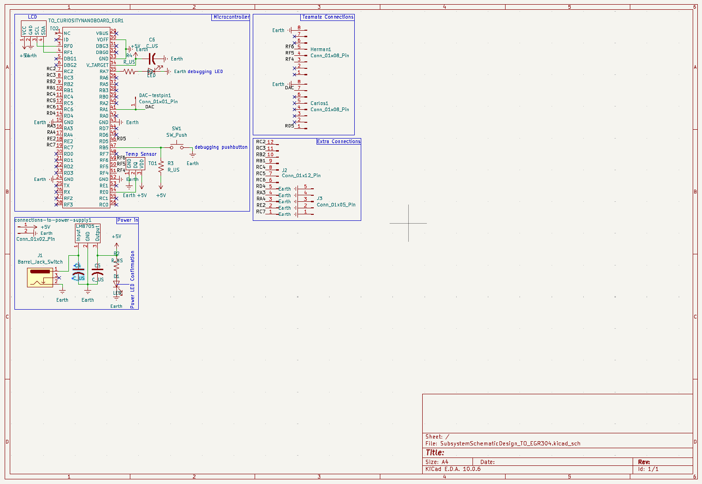

## Overview

This schematic is design to support the temperature monitorization and display of information for our product .... (highlight functionally, power, and controller).

{style width:"350" height:"300;"}
**Figure ##:** Showing Subsystem Schematic 

## Resouces

The schematic as a PDF download is available [*here*](Schematic1.pdf), and the Zip folder of the project [*here*](SubsystemSchematicDesign_TO_EGR304.zip).