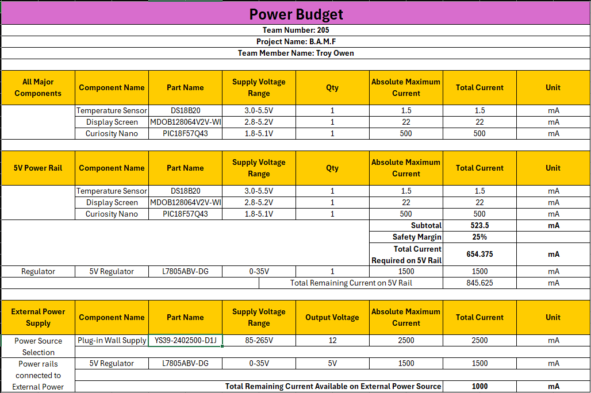

## Overview
The purpose of the power budget was to figure out how much power each component in our plant sensor needs and make sure our power supply can handle it. I looked up the voltage and current requirements for each component, including the temperature sensor, display, voltage regulator, and microcontroller. I also compared different components to see which ones would use less power.

{style width:"350" height:"300;"}

## Conclusions

From the prepare Power Budget, the L7805ABV-DG voltage regulator is rated for up to 1.5 A, leaving approximately 845.625 mA of available current capacity on the rail. The selected 24V wall supply can provide up to 2.5 A, while the regulator is listed as drawing 1.5 A, leaving 1 A of remaining current capacity at the source. Overall, the listed current ratings suggest that the system has sufficient current capacity to operate, even with the safety margin.

## Resouces

The power budget as a PDF download is available [*here*](powerbudget.pdf), and a Microsoft Excel Sheet [*here*](PowerBudgetEGR304TO.xlsx).