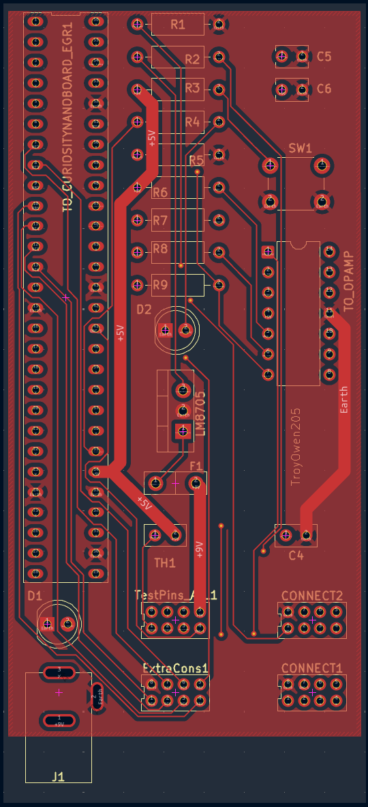
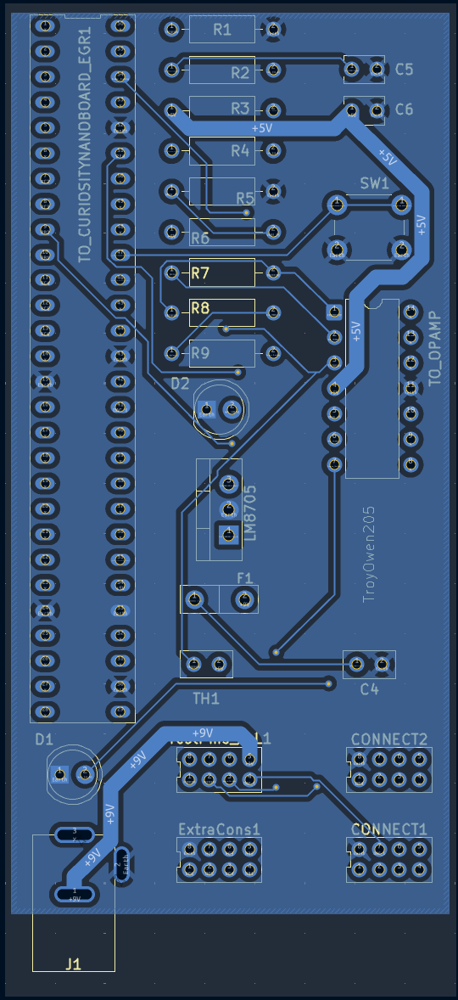

## Overview
The PCB page is meant to portray the Schematic portion of this datasheet in a finished PCB form; as well as the GERBER files for each layer of the PCB.

## Resouces

The PCB as a PDF download is available [here](PCB_SSD_TO_EGR304.pdf), and the Zip folder of the project [here](SubsystemSchematicDesign_TO_EGR304.zip). The Zip folder of the associated Gerber files is available [here](GERBER_SSD_TO_EGR304.zip).